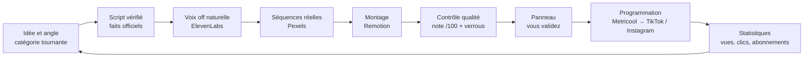

# Studio pub Systeme.io

Un studio de production automatisé qui fabrique chaque jour une vidéo publicitaire verticale
(TikTok et Instagram Reels) pour faire découvrir **Systeme.io** et ses **abonnements payants**
via votre lien affilié — avec de vraies séquences vidéo, une voix off naturelle, un montage
professionnel, un contrôle qualité strict et **votre validation avant toute publication**.

**Panneau de validation :** https://claude.ai/artifact/PHv2PwELy8staCztefioMr
(privé, ouvert avec votre compte claude.ai, utilisable sur téléphone)

## Ce que fait le studio, chaque jour



1. **Choisit un sujet** parmi 13 catégories (publicité directe, formules payantes, tutoriels,
   tunnels de vente, automatisations, formations, erreurs de débutants…) sans jamais répéter
   une accroche ou un angle récent, en tenant compte de vos idées et de ce qui convertit le mieux.
2. **Écrit le script** pour l'oreille, orienté abonnement payant, et le fait passer par un
   contrôleur automatique : aucune promesse de revenus, aucune fausse urgence, aucun superlatif,
   et chaque prix, chiffre ou fonctionnalité doit être prouvé par un extrait de la page officielle
   de Systeme.io copiée le jour même.
3. **Enregistre la voix off** avec une voix ElevenLabs que **vous avez choisie à l'écoute**, puis
   la fait retranscrire pour détecter les mots mal prononcés. Les sous-titres sont calés au mot près.
4. **Cherche les séquences** sur Pexels (vidéos réelles, licence commerciale), les présente sur des
   planches contact, choisit les plus justes et ne réutilise pas un plan avant 45 jours.
5. **Monte la vidéo** : coupes sur le rythme de la voix, mouvements de caméra, étalonnage, grain,
   sous-titres animés, cartes explicatives, captures réelles de Systeme.io si vous en fournissez,
   carte d'appel à l'action, mention « Publicité » visible du début à la fin, musique sous licence
   et habillage sonore. Quatre directions artistiques tournent pour éviter l'effet « modèle ».
6. **Note la vidéo sur 100** (grille ci-dessous) avec un relecteur indépendant et des mesures
   techniques. Moins de 85 : refaite. 85 à 89 : améliorée. 90 et plus : proposée.
7. **La dépose dans le panneau** : vous la regardez avec le son, ajustez la légende ou l'heure,
   et cliquez « Valider et programmer » — la publication part dans Metricool.
8. **Suit les résultats** : vues et visionnage depuis Metricool, clics, inscriptions et
   abonnements payants depuis votre tableau de bord affilié (saisis dans le panneau).

## La grille de qualité

| Critère | Points | Comment c'est mesuré |
|---|---:|---|
| Qualité visuelle | 20 | Relecture indépendante, plafonnée par les mesures (netteté, zones sûres, images noires ou figées) |
| Naturel de la voix | 15 | Voix approuvée par vous + mesures (prononciation retranscrite, débit, pauses) |
| Qualité du montage | 15 | Relecture, plafonnée par le rythme et la variété des plans |
| Qualité du script | 15 | Relecture, plafonnée par les avertissements du contrôleur |
| Explication de Systeme.io | 15 | Relecture |
| Potentiel de conversion | 15 | Relecture, plafonnée si l'appel à l'action est faible |
| Qualité audio | 5 | Mesures (volume EBU R128, crêtes, silences, intelligibilité) |

**Verrous** (bloquent la publication quelle que soit la note) : script non conforme, fait non
vérifié, lien affilié absent ou incorrect, mention « Publicité » absente, droits non prouvés
(séquences, musique, captures), voix non approuvée, vidéo sans voix audible, format non conforme,
problème bloquant relevé à la relecture.

## Ce qu'il vous faut

| Élément | Pourquoi | Coût indicatif |
|---|---|---|
| Lien affilié Systeme.io | Toutes les ventes passent par lui | — |
| Compte ElevenLabs payant | Voix naturelle, vérification de prononciation, musique générée | Creator ≈ 22 $/mois conseillé (Starter ≈ 6 $/mois trop juste) |
| Clé Pexels | Séquences vidéo réelles | Gratuit |
| Metricool (déjà connecté) | Programmation TikTok / Instagram conforme | Votre plan actuel ; Instagram à connecter |
| Claude (votre abonnement) | Écriture, relecture, orchestration | Inclus dans votre plan |

Pas à pas complet : **[docs/mise-en-route.md](docs/mise-en-route.md)**.

## Ce que le studio ne fera jamais

- Publier sans votre validation (sauf si vous activez vous-même la publication automatique).
- Promettre des revenus, inventer une urgence, un témoignage, un prix ou une interface.
- Annoncer « publiée » avant que la plateforme ne l'ait confirmé.
- Contourner les règles de TikTok, d'Instagram ou de Metricool (TikTok interdit les outils
  maison de publication sur son propre compte : la publication passe par Metricool, partenaire agréé).

## Pour aller plus loin

- [Mise en route](docs/mise-en-route.md) — clés, voix, lien affilié, captures, activation
- [Production quotidienne](docs/production-quotidienne.md) — le déroulé suivi par Claude chaque jour
- [Architecture et choix d'outils](docs/architecture.md) — modules, coûts, limites
- [Conformité](docs/conformite.md) — loi influenceurs, licences, plateformes
- [Captures de Systeme.io](assets/systeme/LISEZMOI.md) et [musique sous licence](assets/music/LISEZMOI.md)

### Commandes

```bash
npm ci
```

```bash
npm run studio -- help
```

```bash
npm test
```

Les vidéos du 5 novembre présentes dans `videos/` sont les anciens essais (texte animé sur fond uni) ;
elles ne sont plus utilisées.
