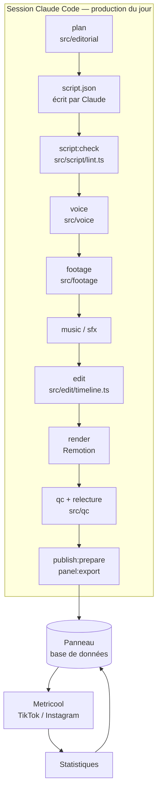

# Architecture et choix d'outils

## Principe : Claude décide, le code vérifie

Les étapes de jugement (angle, script, choix des plans, relecture) sont faites par Claude dans une
session Claude Code ; tout le reste est déterministe et vérifié par le code (`src/`). Chaque étape lit
et écrit des fichiers JSON validés par des schémas (`src/schemas/`), et les verrous de publication
sont dans le code, pas dans une consigne : une note élevée ne peut pas faire passer une vidéo dont un
contrôle obligatoire échoue.

## Modules

| Dossier | Rôle |
|---|---|
| `src/editorial` | Rotation des 13 catégories, anti-répétition (accroches, angles, directions artistiques), brief |
| `src/facts` | Copies datées des pages officielles, vérification mot pour mot des faits |
| `src/script` | Contrôle du script : promesses, urgence, superlatifs, concurrents, faits, durée, répétitions |
| `src/voice` | ElevenLabs avec minutage par caractère, prononciation, mastering, retranscription de contrôle |
| `src/footage` | Recherche Pexels, notation des candidats, planches contact, téléchargement, licences |
| `src/music`, `src/sfx` | Musique sous licence ou générée ; habillage sonore synthétisé (sans licence à gérer) |
| `src/captures` | Captures réelles de Systeme.io et zones à mettre en valeur |
| `src/edit` | Montage : coupes sur la voix, mouvements de caméra, transitions, sous-titres, cartes, mixage |
| `remotion/` | Rendu image par image (React) : plans, étalonnage, grain, titres, sous-titres, carte de fin |
| `src/qc` | Contrôles techniques (ffprobe, EBU R128, images noires ou figées…) et note sur 100 |
| `src/publish` | Vérification du lien affilié, légendes, créneaux, charge Metricool, hébergement du MP4 |
| `src/panel` | Synchronisation avec le panneau (fiches vidéo, réglages, mémoire du studio) |
| `src/analytics` | Statistiques, attribution estimée, indice de performance par catégorie |
| `panel/index.html` | Le panneau de validation (page claude.ai avec base de données et connecteurs) |

## Choix d'outils

| Besoin | Choix | Pourquoi | Limites |
|---|---|---|---|
| Voix off | **ElevenLabs** (multilingual v2 par défaut, v3 testable) | Voix françaises parmi les plus naturelles, minutage par caractère pour des sous-titres exacts, retranscription (Scribe) pour vérifier la prononciation | Payant ; le naturel dépend surtout de la voix choisie, d'où l'audition et votre approbation |
| Séquences | **Pexels** | Vidéos réelles en haute définition, usage commercial autorisé, API gratuite | 200 requêtes/heure ; catalogue vertical plus réduit (paysage 4K recadré accepté) |
| Montage | **Remotion** | Animation image par image en code : typographie, sous-titres au mot, transitions sur mesure | Gratuit pour un particulier ou une entreprise de 3 personnes maximum |
| Encodage, mesures | **FFmpeg** | Standard ; mesures EBU R128, détection d'images noires ou figées | — |
| Publication | **Metricool** (connecteur) | Partenaire agréé TikTok et Meta ; TikTok interdit les outils maison de publication sur son propre compte | Publication TikTok automatique selon le type de compte (sinon notification) |
| Validation | **Panneau claude.ai** | Accessible partout, base de données partagée avec Claude, programmation Metricool d'un clic | Ouvert avec votre compte claude.ai |
| Musique | **Eleven Music** ou pistes sous licence | Pas de musique sans preuve de licence | Conditions musique du plan ElevenLabs à respecter |

## Ce qui n'est pas automatisable (et pourquoi)

- **Clics et abonnements par vidéo** : le lien est dans la bio ; aucune plateforme n'indique quelle
  vidéo a déclenché un clic ou un abonnement. Le studio répartit les chiffres du tableau de bord affilié
  au prorata des vues des 72 heures précédentes, et l'indique comme estimation.
- **Chiffres d'affiliation** : Systeme.io n'offre pas d'accès programmatique à ces statistiques ; vous
  les saisissez dans le panneau (Statistiques).
- **Captures de l'interface** : elles doivent venir de votre compte (enregistrement d'écran) ; le studio
  n'invente jamais d'interface.

## Mémoire entre deux productions

Chaque production repart d'un dépôt neuf. L'historique (accroches, angles, séquences utilisées,
publications, statistiques) et les faits vérifiés sont conservés dans la base du panneau, puis
reconstruits localement au début de chaque production (`panel:import`).

## Hébergement des vidéos pour Metricool

Metricool télécharge la vidéo depuis une adresse publique. Par défaut, `media:push` place le MP4 sur la
branche de travail de la session (dépôt public). Si vous l'autorisez explicitement, le mode
`media-branch` (réglage `media.mode` dans `config/studio.json`) reconstruit une seule branche `media`
ne gardant que les 14 derniers jours, ce qui évite d'alourdir le dépôt.
