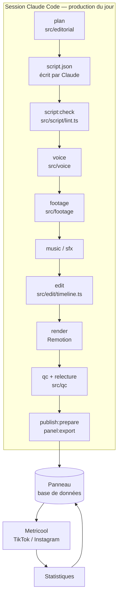

# Architecture et choix d'outils

## Principe : Claude décide, le code vérifie

Les étapes de jugement (angle, script, choix des plans, relecture) sont faites par Claude dans une
session Claude Code ; tout le reste est déterministe et vérifié par le code (`src/`). Chaque étape lit
et écrit des fichiers JSON validés par des schémas (`src/schemas/`), et les verrous de publication
sont dans le code, pas dans une consigne : une note élevée ne peut pas faire passer une vidéo dont un
contrôle obligatoire échoue.

## Modules

| Dossier | Rôle |
|---|---|
| `src/editorial` | Rotation des 14 catégories, anti-répétition (accroches, angles, directions artistiques), brief |
| `src/facts` | Copies datées des pages officielles, vérification mot pour mot des faits |
| `src/script` | Contrôle du script : promesses, urgence, superlatifs, concurrents, faits, durée, répétitions |
| `src/voice`, `scripts/voice_chatterbox.py`, `scripts/voice_local.py` | Voix « Claire » (Chatterbox, phrase par phrase avec réécoute et reprises), voix de secours Siwis (Kokoro) ou, en option, Azure Speech / ElevenLabs ; prononciation, mastering, minutage au mot et contrôle par retranscription (faster-whisper) |
| `src/footage` | Recherche Pixabay (ou Pexels), notation des candidats, planches contact, téléchargement, licences |
| `src/music`, `src/sfx` | Musique libre de droits avec preuve ; habillage sonore synthétisé (sans licence à gérer) |
| `src/captures` | Captures réelles de Systeme.io et zones à mettre en valeur |
| `src/edit` | Montage : coupes sur la voix, mouvements de caméra, transitions, sous-titres, cartes, mixage |
| `remotion/` | Rendu image par image (React) : plans, étalonnage, grain, titres, sous-titres, carte de fin |
| `src/qc` | Contrôles techniques (ffprobe, EBU R128, images noires ou figées…) et note sur 100 |
| `src/publish` | Vérification du lien affilié, légendes, créneaux, charge Metricool, hébergement du MP4 |
| `src/panel` | Synchronisation avec le panneau (fiches vidéo, réglages, mémoire du studio) |
| `src/analytics` | Statistiques, attribution estimée, indice de performance par catégorie |
| `panel/index.html` | Le panneau de validation (page claude.ai avec base de données et connecteurs) |

## Choix d'outils

| Besoin | Choix | Pourquoi | Limites |
|---|---|---|---|
| Voix off | **Chatterbox Multilingual** (MIT), voix « Claire » (timbre : base SIWIS, CC BY 4.0), sur le processeur de la machine de Claude ; **faster-whisper** (MIT) pour réécouter chaque phrase, le minutage et la vérification ; **Kokoro-82M** (Apache-2.0), voix « Siwis », en secours | 0 €, aucun compte ni clé, usage commercial autorisé ; voix choisie à l'écoute par l'utilisateur ; une phrase qui s'écarte du texte est refaite (jusqu'à 4 prises) ; chaque mot est retranscrit et comparé au script (chiffres, homophones et respellings tolérés) | Génération lente sur processeur (quelques minutes par vidéo) ; débit naturel un peu lent, ramené vers 160 mots/min par un étirement qui garde la hauteur de la voix ; Azure F0 ou ElevenLabs en option |
| Séquences | **Pixabay** (Pexels en option) | Vidéos réelles, usage commercial autorisé sans attribution, clé gratuite affichée immédiatement ; recherches mises en cache 24 h comme Pixabay le demande | Clé dans l’adresse de la requête : variable d’environnement `PIXABAY_API_KEY` ; moins de vertical natif (paysage 4K recadré accepté) ; Pexels a suspendu la création de clés |
| Montage | **Remotion** | Animation image par image en code : typographie, sous-titres au mot, transitions sur mesure | Gratuit pour un particulier ou une entreprise de 3 personnes maximum |
| Encodage, mesures | **FFmpeg** | Standard ; mesures EBU R128, détection d'images noires ou figées | — |
| Publication | **Metricool** (connecteur) | Partenaire agréé TikTok et Meta ; TikTok interdit les outils maison de publication sur son propre compte | Publication TikTok automatique selon le type de compte (sinon notification) |
| Validation | **Panneau claude.ai** | Accessible partout, base de données partagée avec Claude, programmation Metricool d'un clic | Ouvert avec votre compte claude.ai |
| Musique | Pistes libres de droits fournies par vous (ex. Pixabay Music) | Pas de musique sans preuve de licence ; sinon voix + habillage sonore | Ajout manuel des pistes |

## Ce qui n'est pas automatisable (et pourquoi)

- **Clics et abonnements par vidéo** : le lien est dans la bio ; aucune plateforme n'indique quelle
  vidéo a déclenché un clic ou un abonnement. Le studio répartit les chiffres du tableau de bord affilié
  au prorata des vues des 72 heures précédentes, et l'indique comme estimation.
- **Chiffres d'affiliation** : Systeme.io n'offre pas d'accès programmatique à ces statistiques ; vous
  les saisissez dans le panneau (Statistiques).
- **Captures de l'interface** : elles doivent venir de votre compte (enregistrement d'écran) ; le studio
  n'invente jamais d'interface.

## Mémoire entre deux productions

Chaque production repart d'un dépôt neuf. L'historique (accroches, angles, séquences utilisées,
publications, statistiques) et les faits vérifiés sont conservés dans la base du panneau, puis
reconstruits localement au début de chaque production (`panel:import`).

## Hébergement des vidéos pour Metricool

Metricool télécharge la vidéo depuis une adresse publique. Par défaut, `media:push` place le MP4 sur la
branche de travail de la session (dépôt public). Si vous l'autorisez explicitement, le mode
`media-branch` (réglage `media.mode` dans `config/studio.json`) reconstruit une seule branche `media`
ne gardant que les 14 derniers jours, ce qui évite d'alourdir le dépôt.
